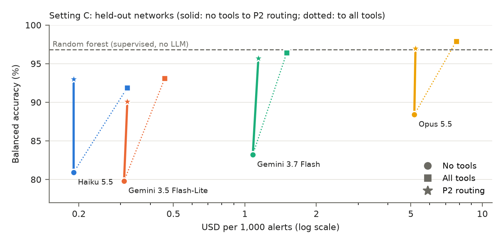
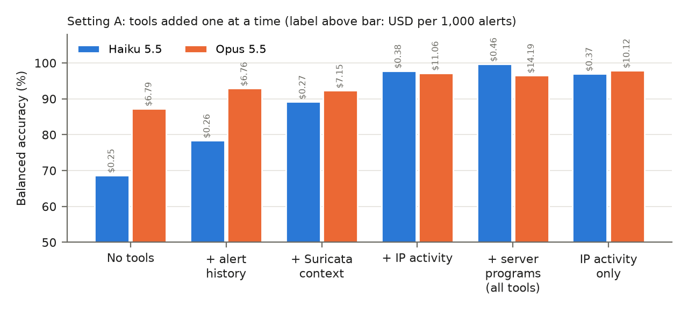

# CoTriage: token-cost-aware tool use for LLM alert triage (pilot)

This repository reports a pilot study of how much each evidence tool adds to a large language model (LLM) that triages intrusion detection alerts, and what it costs in tokens. Repository: https://github.com/aashmauprety/cotriage.

The experiment uses alerts from the public AIT Log Data Sets. An LLM decides for each alert case whether it is an attack, first without evidence and then with up to four tools (alert history, other alarms, activity of the remote IP address, host activity). A routing policy learns from labeled outcomes which tools to call for each alert signature. Four API models were evaluated (Claude Haiku 5.5, Claude Opus 5.5, Gemini 3.7 Flash, Gemini 3.5 Flash-Lite), each run three times.

## Run the experiment

Install Python 3.12 or later and the packages in `requirements.txt`. The LLMs are called through Google Cloud Vertex AI; running them requires a Google Cloud project with access to these models and incurs token charges. No GPU is required.

```sh
python3 -m venv .venv
source .venv/bin/activate
python -m pip install -r requirements.txt
export VERTEX_PROJECT=your-gcp-project
```

The data sets are not included. Download the AIT Log Data Set V1.1 (Setting A), the [AIT Log Data Set V2.0](https://zenodo.org/records/5789064), and the AIT Alert Data Set (Setting C) from Zenodo. For Setting C, `scripts/v2/fetch_all.sh` fetches only the server logs and labels of each network, and `scripts/v2/prepare.sh` labels the alarms and builds the alert cases. Then:

```sh
# Setting C: draw the evaluation sample (seeded), then triage it with one model (all tool configurations)
python scripts/v2/make_sample_v2.py
python scripts/v2/triage_v2.py --model claude-haiku-5-5 --case-file alerts_v2/sample_C.txt --run 1
# evaluate tool configurations, routing, and baselines (leave one network out)
python scripts/v2/analyze_C.py
```

Setting A uses `scripts/make_alert_cases.py`, `scripts/triage.py`, and `scripts/policies.py --all` in the same way. The alert cases and the seeded evaluation sample are rebuilt from the data sets by the scripts. API outputs differ slightly between runs; compare the effects and counts rather than identical numbers.

## Observed results

Setting C: 2,235 alert cases (235 attacks, 2,000 benign) from eight networks, each network held out in turn. BA = balanced accuracy (%). Cost = LLM token cost in USD per 1,000 alerts. Mean of three runs.

| Model | No tools | All tools | P2 routing |
| --- | ---: | ---: | ---: |
| Claude Haiku 5.5 | 80.9 BA, $0.19 | 91.9 BA, $0.32 | 93.0 BA, $0.19 |
| Gemini 3.5 Flash-Lite | 79.8 BA, $0.31 | 93.1 BA, $0.46 | 90.1 BA, $0.32 |
| Gemini 3.7 Flash | 83.2 BA, $1.08 | 96.4 BA, $1.50 | 95.7 BA, $1.14 |
| Claude Opus 5.5 | 88.4 BA, $5.17 | 97.9 BA, $7.76 | 97.0 BA, $5.23 |

A supervised random forest reaches 96.8 BA. Trained on one network (about 280 labeled alerts) it drops to 74.2, while P2 routing keeps 92.3 (Haiku) and 97.5 (Opus). In Setting A (589 Suricata alert cases, 25 attacks), Haiku with the IP-activity tool alone reaches 97.0 BA at $0.37, compared with 87.3 BA at $6.79 for Opus without tools. For Flash-Lite, P2 routing calls too few tools and stays 3.0 points below all tools.

At the natural share of attacks in Setting C (0.93%), Haiku with P2 routing would escalate 13.5 alerts per network and day, 1.4 of them false (precision 90%, recall 86.1%); with all tools it would escalate 87, 75 of them false (`results/operational.md`). Without tools, Haiku's confidence on the attacks it misses (median 0.11) is close to its confidence on benign alerts (median 0.08), so escalating on the model's confidence cannot separate them (`results/confidence_C.md`).





All result tables are in `results/`. `settingC.md` and `tables.md` hold the main numbers; `bootstrap_ci.md` the confidence intervals; `operational.md` precision, recall, and escalations per day; `confidence_C.md` the model confidence on missed attacks; `train_size_C.md`, `generalization_C.md`, `prompt_test*.md`, and `rename_test.md` the robustness checks; `token_counts.md` the tokens per alert for recomputing cost at other prices.

## Manuscript downloads

[Compiled PDF](paper.pdf)

## License

Code: MIT (see `LICENSE`). Manuscript, results, and figures: CC BY 4.0.
